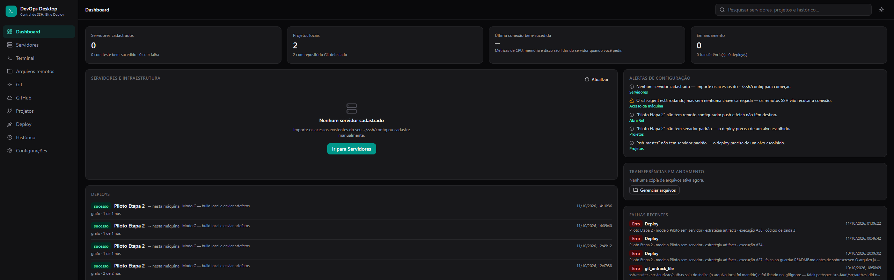
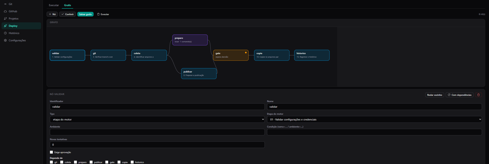
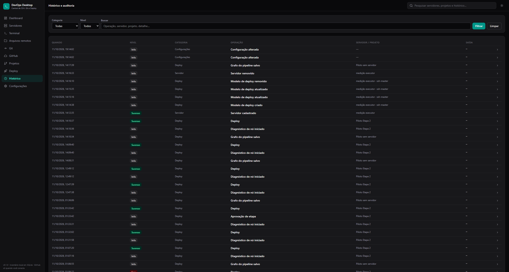

# DevOps Desktop — Central de SSH, Git e Deploy

Aplicativo desktop para quem administra servidores e publica projetos: cadastre e teste acessos SSH, navegue e
transfira arquivos por SFTP, use terminal integrado, opere Git por interface gráfica e publique com um clique em
pipeline visual — tudo com as ferramentas nativas do sistema (OpenSSH, Git) e histórico local auditável.

**Nada é simulado.** Cada conexão, transferência, commit, push e deploy executado aqui é executado de verdade no
servidor ou no repositório. Quando uma etapa obrigatória falha, a interface mostra a falha — nunca um sucesso inventado.

- **Licença:** MIT ([LICENSE](LICENSE))
- **Plataforma principal:** Windows 10/11 (arquitetura preparada para Linux e macOS)
- **Stack:** Rust + Tauri 2 · React 19 + TypeScript + Vite · Tailwind CSS 4 · SQLite (rusqlite) · Git nativo · OpenSSH nativo

---

## 1. Sumário

- [O que o aplicativo faz](#2-o-que-o-aplicativo-faz)
- [Capturas de tela](#capturas-de-tela)
- [Requisitos](#3-requisitos)
- [Instalação (usuário)](#4-instalação-usuário)
- [Compilação (desenvolvedor)](#5-compilação-desenvolvedor)
- [Execução em desenvolvimento](#6-execução-em-desenvolvimento)
- [Geração do instalador Windows](#7-geração-do-instalador-windows)
- [Configuração](#8-configuração)
- [Utilização](#9-utilização)
- [Modelo de segurança](#10-modelo-de-segurança)
- [Arquitetura](#11-arquitetura)
- [Testes](#12-testes)
- [Solução de problemas](#13-solução-de-problemas)
- [Contribuição e licença](#14-contribuição-e-licença)

O registro por etapa do que já está entregue, onde está o código, como se prova cada parte e o que falta para retomar
está em [docs/ENTREGAS.md](docs/ENTREGAS.md).

---

## 2. O que o aplicativo faz

| Área | O que você consegue fazer |
| --- | --- |
| **Servidores SSH** | Importar automaticamente os acessos já existentes em `~/.ssh/config`, cadastrar manualmente, organizar por ambiente (dev, staging, produção, banco, Docker), testar conexão com diagnóstico real (DNS, porta, autenticação, chave de host). |
| **Arquivos remotos (SFTP)** | Navegar, criar pasta, renomear, mudar permissão, ver/editar arquivo de texto, baixar e enviar (inclusive pastas), com progresso, velocidade e cancelamento. |
| **Terminal** | Sessões PTY múltiplas ligadas a um servidor, com redimensionamento, histórico de comandos local e encerramento limpo ao fechar a janela. |
| **Git** | Status, stage por arquivo ou por trecho (hunk), diff linha a linha, commit (com amend), gráfico de histórico de commits, árvore dos arquivos rastreados com o conteúdo que o Git guarda no HEAD, branches locais/remotas, criar/renomear/excluir/alternar, merge, rebase, resolução de conflito com lado escolhido, fetch/pull/push, tags, remotes, clone, reverter commit e mover a cabeça do ramo, publicação pelo Git (comandos locais + push + tag), teste de acesso ao remoto e abrir o repositório no editor (VS Code/Cursor/system). Funciona sozinho: nenhuma dessas ações depende de haver um servidor cadastrado. |
| **Acesso da máquina** | Detectar o que está instalado (`ssh`, `ssh-add`, `git`, `gh`), quantas chaves o `ssh-agent` tem, a identidade que o git resolve, os editores encontrados no disco e a conta ativa do `gh`; dizer se a máquina já está liberada para publicar e, quando não está, abrir o navegador no fluxo de autorização do GitHub e confirmar `liberado como @login`. |
| **Deploy** | Cinco estratégias reais: **A** SFTP sincronizado, **B** Git no servidor, **C** build local + artefatos, **D** sequência de scripts, **E** Docker/Compose. Pipeline visual de até 15 etapas com log, código de saída, verificação de ferramentas no servidor antes de executar, cancelamento cooperativo, release anterior preservada e rollback assistido; ou um **grafo** desenhado na tela (etapas do motor, comandos, aprovações, passos de git e varredura de código, com dependências, prazo, repetição e condição por nó) que o mesmo motor percorre. O destino pode ser **esta máquina** (sem SSH, com **C** ou **D**): comparação por conteúdo, cópia só do que mudou, ponto de recuperação em `.devops-backups` e reversão que repõe inclusive os arquivos removidos da limpeza. |
| **Segurança** | Bloqueio de commit/push quando o conteúdo que o Git publicaria contém segredo, varredura de projeto, regras extras configuráveis, remoção assistida do índice sem apagar o arquivo local. |
| **Análise de código** | Varredura estática do código-fonte de um projeto com o analisador embutido (19 regras em YAML), com o **semgrep** externo, ou com os dois; corte de severidade escolhido por você, que decide se a varredura barra a publicação — nunca o código de saída da ferramenta. Histórico local por corrida, com cobertura, achados por regra e trecho de código já mascarado, exportação do pacote `devops-desktop/analise@1` (JSON) e de SARIF para um revisor humano ou uma IA, e o mesmo veredito disponível como nó **análise de código** dentro do grafo do deploy. |
| **Dashboard** | Estado dos servidores, deploys recentes e resultado, falhas do histórico, transferências em andamento, alertas de configuração e métricas reais de CPU, memória, disco, containers e serviços — lidas do servidor só quando você pedir. |
| **GitHub** (opcional) | Conectar a conta pelo fluxo de dispositivo do OAuth e trabalhar o repositório de dentro do app: bandeja com o que é seu (revisão pedida, seus PRs, suas issues), pull request com diff real, conversa de comentários, revisão (aprovar / pedir alterações) e mesclar com método escolhido, abrir um PR a partir de um ramo desta máquina, mapear a pasta local de um repo publicado — o app mostra o caminho exato e abre a pasta no Explorador — e abrir ali mesmo a seção Git completa daquela pasta (aba **Local**), issues com descrição e comentários, execuções do Actions com reexecução, visão geral que liga o remoto às pastas locais (clonar, vincular como `origin`) e criação de repositório. Tudo com confirmação nas ações que escrevem; sem conta conectada, a aba mostra só a conta e o Client ID. |
| **Auditoria** | Tudo fica em SQLite local, pesquisável e filtrável por servidor, projeto, tipo, nível e resultado. |

---

## Capturas de tela

As três capturas abaixo são do aplicativo rodando, com dados reais do uso local — sem servidor cadastrado no momento
da captura, por isso o Dashboard mostra `0` servidores e as falhas do histórico à direita.

**Dashboard** — estado geral, lista de deploys com data e estratégia, e os dois painéis que só mostram o que já
executou de verdade: falhas recentes e transferências em andamento.



**Deploy · grafo** — pipeline desenhado na tela: nós com dependência entre si, um nó de espera de decisão (âmbar) e o
formulário do nó selecionado embaixo, com tipo, etapa do motor, ambiente, condição, tentativas e quem depende de quem.



**Histórico e auditoria** — o inventário local em SQLite, pesquisável e filtrável por categoria e nível. Cada linha é
uma operação que ocorreu, com data, servidor/projeto e saída.



---

## 3. Requisitos

**Para usar (Windows):**

- Windows 10 ou 11.
- **OpenSSH** no `PATH` (`ssh.exe`, `scp.exe`/`sftp.exe`). Opcional: `ssh-agent` se quiser chave com passphrase sem digitar senha toda hora.
- **Git** no `PATH` para o gerenciador Git e para o deploy por Git.
- **WebView2 Runtime** — necessário para a janela. O Windows 10 (1803+) e o Windows 11 já trazem; em sistemas
  antigos instale antes o *Microsoft Edge WebView2 Runtime*.

- **GitHub CLI (`gh`)** — *opcional*. Quando existe e tem sessão (`gh auth login`), entra como mais um caminho de
  liberação listado em **Configurações → Acesso da máquina**. Nada no aplicativo exige `gh`.

O aplicativo **não** instala dependência nenhuma por conta própria. Ele **detecta** o que existe e **diz se esta
máquina já está liberada para publicar**, em **Configurações → Acesso da máquina** (botão *Reverificar*): versões reais
de `ssh`/`ssh-add`/`git`/`gh`, se o `ssh-agent` está rodando e quantas chaves tem, a identidade que o git resolve nesta
máquina, os editores instalados e a conta ativa do `gh`. Cada sondagem tem prazo de 5 s e as sete rodam em paralelo: uma
ferramenta travada é nomeada na tela ("instalado, mas não respondeu") em vez de deixar o painel girando. Quando falta
liberação, o próprio painel abre o navegador no fluxo de dispositivo do GitHub, mostra o código de verificação e confirma
a liberação como `@login` assim que você autoriza. A prova final por repositório está na aba Git, no botão
**Testar acesso** (§9.5).

**Para compilar:**

- [Rust](https://www.rust-lang.org/tools/install) estável (1.77+).
- [Node.js](https://nodejs.org) 20+ e npm.
- Microsoft C++ Build Tools (componente *Desktop development with C++*) — exigido pelo `tauri-build` no Windows.
- Dependências nativas no Linux (build Tauri): `libwebkit2gtk-4.1-dev`, `build-essential`, `libssl-dev`, `libayatana-appindicator3-dev`, `librsvg2-dev`.

---

## 4. Instalação (usuário)

1. Obtenha o instalador — `DevOps Desktop_0.1.0_x64-setup.exe` (NSIS) ou `DevOps Desktop_0.1.0_x64_en-US.msi`
   (MSI). Ele é gerado por [`npm run tauri build`](#7-geração-do-instalador-windows); quando houver Releases no
   repositório, está lá.
2. Execute e siga o assistente.
3. Abra o aplicativo. Na primeira execução ele cria o banco local em:

   ```
   %APPDATA%\com.douglasgdev.devopsdesktop\devops-desktop.db
   ```

4. Vá em **Servidores → Importar do ~/.ssh/config**. A leitura é não destrutiva: o arquivo e as chaves originais não
   são movidos, copiados nem alterados — o aplicativo apenas interpreta o que já existe.

Nenhuma conta, telemetria ou servidor externo é usado. Os dados ficam apenas neste computador.

---

## 5. Compilação (desenvolvedor)

```bash
git clone https://github.com/DouglasGDev/devops-desktop.git
cd devops-desktop

npm install          # dependências do frontend
npm run build        # tsc --noEmit + vite build (dist/)

cargo test --lib     # testes do backend, dentro de src-tauri/
cd src-tauri && cargo build   # binário de debug
```

O frontend e o backend são independentes no desenvolvimento: `npm run build` valida tipos e gera `dist/`, e
`cargo test --lib` roda a lógica de SSH, Git, SFTP, deploy e segurança sem abrir janela.

---

## 6. Execução em desenvolvimento

```bash
npm run tauri dev
```

Isso sobe o Vite em `http://localhost:1420` e abre a janela Tauri apontando para ele. Se a porta 1420 já estiver em
uso por outro processo, libere-a ou encerre o processo anterior — o Tauri não escolhe outra porta sozinho.

Para apenas a interface no navegador (sem comandos nativos, útil para mexer em layout):

```bash
npm run dev
```

Nesse modo as chamadas ao backend falham, porque quem executa SSH/Git/SFTP é o processo Rust.

---

## 7. Geração do instalador Windows

```bash
npm run tauri build
```

O comando roda `npm run build`, compila em release e gera os dois pacotes configurados em
`src-tauri/tauri.conf.json` (`bundle.targets: ["nsis", "msi"]`).

O executável embute o `dist/` que existia **quando o Rust compilou**, não o que existe quando ele terminou: mexer em
`src/` com `npm run tauri build` rodando gera um instalador com frontend velho. A conferência é direta — abra o app e
compare o hash de `/assets/index-*.js` que a janela carrega com o arquivo em `dist/assets/`; se diferirem, refaça
`npm run build` e depois o bundle, sem editar nada no meio. Saída real desta versão:

```
src-tauri/target/release/bundle/
├── nsis/DevOps Desktop_0.1.0_x64-setup.exe      (4,57 MiB)
└── msi/DevOps Desktop_0.1.0_x64_en-US.msi       (6,59 MiB)
```

O instalador NSIS é o recomendado para uso individual; o MSI atende implantação por GPO/domínio. O `bundle` já traz
editor, página inicial, categoria (`DeveloperTool`), licença MIT e descrições usadas pelos instaladores, e o
`webviewInstallMode` está como `downloadBootstrapper` — modo padrão do Tauri para o WebView2.

Para assinatura digital, configure a assinatura do Tauri (`tauri build --signer`) quando houver certificado — sem isso o
instalador continua funcionando, e o Windows exibe o aviso padrão de editor não assinado.

Linux: os alvos `deb`, `rpm` e `AppImage` são suportados pelo Tauri; adicione o formato desejado em
`bundle.targets` para gerar pacotes Linux. Nesta entrega o foco validado é Windows — os pacotes Linux ainda não foram
gerados e testados aqui.

---

## 8. Configuração

### 8.1 Dentro do aplicativo (Configurações)

| Chave | Onde | Efeito |
| --- | --- | --- |
| Tema | Interface | Escuro ou claro. |
| `confirm_destructive` | Configurações | Pede confirmação antes de operação destrutiva (padrão: ligado). |
| `git_editor` | Configurações | Editor usado por "abrir no editor": `system` ou um dos suportados **encontrados nesta máquina** (`vscode`, `cursor`). As opções do campo vêm da detecção, e uma escolha salva que deixou de existir aparece marcada como *não encontrado*. |
| `secret_patterns` | Configurações → Proteção de segredos | Regras extras, uma por linha, somadas às regras internas de nome/extensão/conteúdo. |
| `terminal_history_enabled` | Configurações | Liga/desliga o histórico local de comandos do terminal. |
| `github_client_id` | GitHub → Client ID | Identificador **público** da OAuth App usada no fluxo de dispositivo. Não é segredo; um token de acesso é recusado nesse campo. |

### 8.2 Arquivos que o aplicativo lê (e nunca escreve)

- `~/.ssh/config` e arquivos incluídos: fonte dos acessos importados.
- `git config --get user.name` / `user.email`: **lidos** apenas para mostrar a identidade que o git usaria nesta
  máquina (Configurações → Acesso da máquina). O aplicativo não escreve nenhuma configuração do git.
- `~/.ssh` chaves privadas: usadas **no lugar**, pelo OpenSSH nativo. O aplicativo não copia, move nem reescreve chaves.
- `~/.ssh/known_hosts`: validação de chave de host, sempre ativa. No **terminal integrado** o OpenSSH pergunta
  (`StrictHostKeyChecking=ask`) — a confirmação aparece na própria sessão, e só depois a chave entra no `known_hosts`.
  Nas rotas automatizadas (teste de conexão, SFTP, execução de deploy) a checagem é estrita
  (`StrictHostKeyChecking=yes`): host desconhecido é **recusado** com o erro classificado "Chave de host desconhecida
  ou alterada". Em nenhum caminho a verificação é desligada ou reduzida para `no`.

### 8.3 Autenticação

Três formas, escolhidas por servidor:

1. **SSH Agent** — recomendado para chave com passphrase.
2. **Chave privada** — caminho do arquivo; se a chave tiver passphrase, o agente é o caminho preferido.
3. **Senha** — suportada. A senha é pedida na interface **no momento da operação**, entregue ao OpenSSH por
   `SSH_ASKPASS` em memória e descartada ao terminar. Não é salva no banco, no log nem na configuração.

### 8.4 Servidores sem ferramenta instalada

Nada é presumido. Antes de um deploy, a etapa de verificação executa comandos de leitura no servidor para confirmar
`git`, `docker`, `node`, `php`, `rsync` etc. conforme a estratégia. Se faltar algo, o pipeline falha nessa etapa com a
mensagem "ferramenta ausente" e o log da checagem — sem tentar adivinhar caminho nem instalar nada.

O **executor de runtime** entra nessa mesma lista pelo que ele é: um modelo em Docker ou Docker Compose exige `docker` no
servidor, e um modelo em PM2 exige `pm2` e `node`. A recusa diz o nome do executor e o que falta ("… o executor PM2 roda
com elas"), e nada é instalado por conta própria.

### 8.5 Conta GitHub (opcional)

A seção **GitHub** só funciona com um *Client ID* de OAuth App. Ele **não** é um segredo: é o identificador público da
aplicação, e por isso pode ficar no banco local.

1. Em `github.com/settings/developers` (New OAuth App), o formulário pede três valores e nenhum deles exige servidor
   próprio: **Application name** é livre; **Homepage URL** aceita qualquer endereço público — o deste repositório serve
   (`https://github.com/DouglasGDev/devops-desktop`); **Authorization callback URL** precisa ser digitado, mas o fluxo de
   dispositivo **nunca redireciona para ele**, então repita o mesmo endereço da homepage. Sem domínio, sem hospedagem,
   sem porta aberta.
2. Marque **Enable Device Flow**, salve e copie o **Client ID** que aparece no topo da página do app. O **Client
   secret** existe só para o fluxo de website com backend e ele **não** vai para nenhum lugar desta aplicação.
3. No aplicativo, em **GitHub → Configuração → Client ID da OAuth App**, cole o identificador e salve. O campo aceita os três
   formatos que o GitHub já emitiu para um Client ID — os atuais, base62 de ~20 caracteres com maiúsculas e minúsculas
   (`Ov23li…`), os antigos hexadecimais (20 ou 40), e `Iv1.` + hexadecimal de um GitHub App. Token de acesso é recusado
   de propósito (tem `_` ou `-`), para ninguém persistir um segredo nesse campo. **Cuidado com um ponto**: o *Client
   secret* é hexadecimal e cabe na mesma regra, então nada neste aplicativo percebe se você colar o secret no lugar do
   ID — e o GitHub responde com 404, que é a frase "o GitHub não reconhece o que foi enviado". É o campo **Client ID**,
   no topo da página do app. Se o secret foi salvo aqui por engano, gere um secret novo no GitHub: ele ficou no banco
   local em texto puro até você substituir o valor.
4. Clique em **Conectar conta**: aparece um código de verificação; abra `github.com/login/device`, digite o código e
   autorize. O aplicativo repete a pergunta ao GitHub no intervalo que o próprio GitHub informou. O mesmo fluxo também
   está em **Configurações → Acesso da máquina** (*Liberar pelo navegador*), que é onde o painel confirma a liberação
   exibindo `liberado como @login`.

O token (`repo,user`) vive **apenas na memória do processo**: não vai para o SQLite, para os logs nem para o disco, e
fecha junto com o aplicativo — ao reabrir, é preciso reconectar. A leitura do login (`GET /user`) é o que confirma a
conexão na tela; se ela falhar, **a autorização continua guardada** e o aviso diz o que falhou, em vez de aparecer como
"conexão falhou" o que foi apenas uma leitura a mais (proxy corporativo que deixa passar `github.com` e trava
`api.github.com` é o caso comum). As perguntas de acompanhamento respeitam o intervalo que o próprio GitHub informou,
atualizado a cada tentativa, para não tomar 429. Toda requisição vai para `https://api.github.com`
(host fixo no código; a interface não aceita URL de API). Em rede corporativa com proxy, a seção reporta a falha de
transporte em vez de mostrar dados de exemplo.

---

## 9. Utilização

### 9.1 Fluxo principal (o critério de sucesso do projeto)

1. **Abrir o aplicativo.**
2. **Encontrar os acessos SSH** — *Servidores → Importar do ~/.ssh/config*, revisar ambiente e nome, importar.
3. **Selecionar um servidor** — *Testar conexão* para validar DNS, porta, autenticação e chave de host.
4. **Selecionar um projeto local** — *Projetos → Adicionar a partir de pasta*; a pasta é detectada como repositório Git
   quando for.
5. **Editar e revisar** — *Git*: diff por arquivo/hunk, stage seletivo, commit com mensagem própria.
6. **Publicar** — dois caminhos, e nenhum depende do outro:
   - *Git → Publicar*: roda os comandos locais do projeto, envia o ramo e marca com tag. Não precisa de servidor
     cadastrado; é o caminho de quem só quer usar o gerenciador Git.
   - *Deploy*: escolher o perfil, revisar a pré-verificação (arquivos, tamanho, segredos, ferramentas), acompanhar o
     pipeline etapa a etapa no servidor.
7. **Se algo falhar** — o resultado fica registrado como falha, com a etapa, o comando e o código de saída; no deploy,
   *Rollback* reaponta para a release anterior quando a estratégia tiver release anterior; no Git, a publicação pode ser
   desfeita com *Reverter este commit* e *Despublicar* a tag.

### 9.2 Servidores

- **Adicionar**: nome, host, porta, usuário, autenticação, chave, alias do `ssh_config`, ambiente, grupo e notas.
- **Importar**: leitura do `~/.ssh/config` com relatório do que foi reconhecido e do que foi ignorado.
- **Testar**: resultado classificado (autenticação, DNS, porta recusada, tempo limite, chave de host, sem rota) com a
  mensagem real do OpenSSH, sem segredos.

### 9.3 Arquivos

Navegação por diretório remoto com permissões, tamanho e data; editar texto no aplicativo; criar/renomear/excluir
(arquivo e pasta) com confirmação; upload/download com taxa, tempo restante estimado e cancelamento. Pastas inteiras
com cópia recursiva.

### 9.4 Terminal

Uma sessão por aba, redimensionável, com envio de texto e controle de tamanho. Comandos digitados podem ser registrados
no histórico local (opcional) para reutilização e auditoria. Fechar a janela encerra os processos PTY.

### 9.5 Git

- **Abrir a pasta do repositório**: sem conta de nenhum serviço no meio. O seletor nativo de pastas devolve o caminho,
  a pasta é canonicizada e sondada, e só entra na lista se realmente for um repositório Git — uma pasta comum é
  desfeita na hora e a tela diz isso. O mesmo card oferece *Clonar repositório* para uma pasta do computador.
- **Alterações**: arquivos staged/unstaged/untracked, diff lado a lado por linha, stage por trecho.
- **Árvore**: a lista de arquivos que o Git rastreia (`git ls-files`), montada como árvore colapsável a partir dos
  caminhos — sem caminhar no disco. Cada linha traz o estado lido do `git status` ao lado do nome (adicionado,
  modificado, removido, renomeado, não rastreado, conflito), e a árvore é relida quando o índice muda: um stage ou
  commit feito na própria janela já aparece refletido. Clicar num arquivo abre o diff do lado em que ele tem mudança
  (índice ou disco); sem mudança pendente, o que se abre é o **conteúdo que o Git guarda no HEAD**, lido com
  `git show HEAD:<caminho>`. Arquivo binário, texto fora de UTF-8 e conteúdo acima de 512 KiB são ditos como estados na
  tela — não há texto inventado no lugar. Dali, *Abrir no editor* chama o editor configurado com aquele arquivo.
- **Commit**: mensagem livre, `amend` com aviso de reescrita de histórico (nunca feito automaticamente).
- **Guardados** (`git stash`): o que está na mão sai da pasta e fica endereçado pelo próprio Git, para você trocar de
  ramo ou puxar sem conflito. *Guardar* aceita um nome opcional e a opção de levar também os arquivos ainda não
  rastreados; sem alteração na pasta o botão fica desabilitado e, se mesmo assim o Git responder "no local changes", a
  frase dele é mostrada e nada entra na lista. Cada linha da lista traz o endereço (`stash@{0}` é o mais recente), o
  assunto, o `sha` e a data que o Git gravou, e quatro ações: *ver o que há dentro* (o diff do guardado, lido com o mesmo
  parser do diff local, antes de aplicar), *Aplicar* (o conteúdo vem e a entrada continua na lista), *Aplicar e tirar*
  (`pop`) e *Excluir* (confirmação, porque o conteúdo não é aplicado antes). Conflito na aplicação não é escondido: a
  pasta fica em conflito, o Git **mantém** a entrada e a barra de estado diz exatamente isso. O guardado é local — nada
  vai a um remoto por aqui.
- **Histórico**: gráfico de commits com branches e tags, detalhe do commit, diff entre dois commits/branches.
- **Reversão**: no detalhe de um commit há três ações distintas. *Reproduzir este commit* grava um commit novo neste ramo
  com as mudanças daquele (`git cherry-pick`) — o ramo de origem não é modificado e nada é enviado ao remoto; um merge
  precisa dizer qual pai continua (a confirmação já assume o pai 1 e avisa). *Reverter este commit* grava um commit novo com as
  mudanças invertidas (`git revert --no-edit`) — o histórico não é reescrito, então funciona até em ramo já publicado,
  e um merge exige dizer qual pai continua. *Voltar para este commit* move a cabeça do ramo (`git reset`) e a confirmação
  mostra os três modos com o efeito real de cada um: `soft` mantém o índice como está, `mixed` solta o índice e preserva
  os arquivos, `hard` substitui o conteúdo em trabalho — por isso o botão de `hard` é o de operação destrutiva, e a
  contagem de alterações em andamento aparece no aviso. Nenhuma dessas duas ações toca o remoto: se voltar a cabeça criar
  divergência com o branch acompanhado, o próprio Git recusa o envio comum, e reescrever histórico remoto é algo que a
  aplicação não faz sozinha.
- **Branches**: criar, alternar, renomear, excluir (com confirmação), remotas visíveis.
- **Merge/Rebase**: executados com saída do Git tratada; conflito abre a escolha de lado por arquivo. A barra de operação
  em andamento diz **qual** operação o Git tem parada, lida das marcas do `.git` (`MERGE_HEAD`, `rebase-merge`,
  `CHERRY_PICK_HEAD`, `REVERT_HEAD`) — não é suposição deduzida da cabeça avulsa. Ela oferece *Cancelar* (volta ao estado
  de antes), *Continuar* (conclui o passo com a mensagem que o próprio Git preparou) e, quando o passo não tem conflito
  nenhum — por exemplo um commit que já está aplicado e não deixou mudança — *Pular este passo*. Merge não tem
  `--continue`: ele se conclui com o commit normal, e a barra diz isso em vez de oferecer botão que falharia.
- **Remotos**: listar, adicionar, mudar URL, remover; fetch/pull (merge ou rebase)/push com rastreio de branch.
- **Publicar (canivete, sem servidor)**: o botão *Publicar* na barra do Git abre uma janela que executa, nesta ordem e
  só depois do clique, a checagem de segredos do que o remoto ainda não tem, os comandos locais digitados (um por
  linha, rodados na pasta do projeto com prazo de 10 minutos cada — `npm test`, `npm run build`), o `git push` do ramo
  atual (com `--set-upstream` quando o ramo ainda não tem rastreio) e, se uma tag for informada, criá-la no commit
  atual e enviá-la (`git push <remoto> refs/tags/<nome>`). Se um comando local falhar, o erro com as últimas linhas da
  saída aparece e **nada é enviado**; os comandos ficam salvos por projeto para a próxima publicação. A janela mostra a
  saída real de cada etapa. O contrário também existe: *Despublicar* numa tag faz `git push <remoto> :refs/tags/<nome>`,
  que retira a referência do remoto sem reescrever commit algum e sem apagar a tag local. Reverter o conteúdo publicado
  é a ação *Reverter este commit* acima, seguida de *Enviar*.
- **Testar acesso (liberação da máquina)**: o botão *Testar acesso* roda `git ls-remote <remoto> HEAD` na pasta do
  projeto com prazo de 25 segundos, stdin fechado e prompt de credencial desativado (`GIT_TERMINAL_PROMPT=0`,
  `GCM_INTERACTIVE=never`) — por isso ele não pendura a interface nem fica esperando senha. O veredito vem em uma
  frase: liberado (com o `HEAD` curto do remoto), remoto vazio (recém-criado, publicar ainda funciona) ou o que falta
  — credencial, endereço que não é repositório, rede ou prazo estourado. Só o nome do remoto aparece no resultado,
  nunca a URL. É leitura de referência: nada é escrito no remoto.
- **Segredos**: antes do commit e do push, a aplicação lê **o conteúdo que o Git publicaria** (`git show :path` do
  índice e `git show HEAD:path`) e bloqueia quando há segredo, mostrando caminho e motivo — nunca o valor.
  Há ação assistida para tirar do índice (`git rm --cached`) mantendo o arquivo local e listando no `.gitignore`.

### 9.6 Deploy

Perfil por projeto com **destino** — um servidor SSH ou uma pasta desta máquina — e estratégia (A–E), diretório de
destino, branch, comandos de build, lista de artefatos, sequência de scripts, variáveis (nome/valor, com valores
sensíveis marcados como secretos e enviados pelo ambiente do processo, não pelo log), diretório de releases e symlink
de `current`. No destino "Nesta máquina" as estratégias disponíveis são **artefatos** e **script**, e o symlink de
release não existe (a publicação escreve direto na pasta de destino).

O pipeline executa, em ordem: verificação de requisitos → preparo local → transferência → troca de release → comandos
no servidor → verificação final. Cada etapa mostra comando, duração, código de saída e mensagem. Cancelar interrompe de
forma cooperativa e registra a execução como cancelada. **Se uma etapa obrigatória falha, o resultado final é falha.**

**A pré-vistoria manda no botão.** *Publicar* fica bloqueado até a pré-vistoria rodar: é ela que mostra quantos arquivos
subiriam, quantos bytes, o que a checagem de segredos encontraria e o que ela bloquearia. A pré-vistoria só lê o disco
local — nada é enviado —, então o que ela diz é o que a publicação faria com aquele modelo. Quando ela encontra item
bloqueado, a publicação só volta a existir depois de marcar a autorização explícita de publicar mesmo assim; sem essa
marca o botão continua parado, e quem passa por cima dele lê o motivo do estado atual — falta de modelo, pré-vistoria
pendente, itens bloqueados sem autorização ou execução já em andamento.

**Publicar sem servidor** (destino "Nesta máquina"): as quinze etapas são as mesmas, com dois nomes trocados — a conexão
vira **Abrir a pasta de destino** e o envio vira **Copiar os arquivos para o destino**. A comparação é por CRC32 do
arquivo, então só o que realmente mudou é copiado; o resto da etapa informa quantos ficaram inalterados e quantos
foram deixados de fora. O ponto de recuperação fica em `<destino>/.devops-backups/<execução>/`: antes de sobrescrever,
o arquivo que já estava no destino é copiado para lá, e **Reverter** repõe esse conteúdo. Com *apagar excedentes*
ligado, o arquivo a mais no destino é **movido** para a mesma guarda em vez de removido — nada desaparece sem poder
voltar. O motor exige que o destino seja uma pasta absoluta nomeada, fora da pasta do projeto: raiz de disco (`D:\`,
`/`), caminho relativo, trecho com `..` e destino dentro do próprio código-fonte são recusados — a tela do modelo já
barra na hora de salvar, e a primeira etapa confirma antes de copiar qualquer arquivo (medido nesta máquina: o modelo
com destino `E:/ssh-master/publicado` falhou na etapa 1 com "a pasta de destino está dentro do projeto" sem tocar no
disco).
Comandos de preparação, teste, build, reinicialização e checagem de saúde rodam nesta máquina (`cmd /C` no Windows,
`sh -c` no Unix), com o mesmo prazo e cancelamento cooperativo do modo remoto, e a saída passa pela mesma máscara de
segredos. Na estratégia **C**, o que a preparação ou o build gera entra na cópia: depois desses comandos a seleção é
refeita e passa de novo pela checagem de segredos antes do envio — e se o caminho declarado ainda não existir porque é
justamente o que o comando produz, a etapa de identificação espera em vez de falhar (a cobrança vem depois do comando,
com o mesmo recado de caminho). Na **D** nada é copiado: a publicação são os comandos, e os caminhos de inclusão não
entram em jogo — nem na pré-vistoria, que usa a mesma regra.

**Definição versionada e procedência.** O modelo de deploy é a definição do pipeline, e cada salvamento sobe o número
dela (`v1`, `v2`, …) deixando guardado o retrato do que ela era — estratégia, destino, branch, inclusion/exclusion,
comandos, checagens de saúde e os **nomes** das variáveis. Os valores nunca entram no retrato. Em
**Projetos → Modelos de deploy** o botão de conferência roda as mesmas checagens da primeira etapa do motor, sem executar
nada (por isso a tela nunca aprova o que o motor recusaria), e o botão de histórico lista as versões salvas.
Cada execução registra de onde saiu: versão da definição, destino, ambiente e o commit da pasta no instante em que a
execução abriu. Execuções antigas, anteriores a esse registro, aparecem sem procedência em vez de ganharem uma
inventada.
**Repetir** só é oferecido quando é seguro: se alguma etapa a partir da criação do ponto de recuperação no destino
chegou a trabalhar, o resultado lá é desconhecido e o botão devolve o motivo com a etapa e o status em causa, pedindo
que o destino seja conferido antes de publicar de novo. Uma execução que terminou bem pode ser republicada; uma sem
nenhuma etapa registrada não pode. Repetir nunca herda a autorização de segredos da execução anterior — os valores são
pedidos de novo.
**Execução interrompida**: se o aplicativo for fechado com um pipeline rodando, a abertura seguinte marca essa execução
como interrompida, com o motivo, e nenhuma publicação é refeita por conta própria.

**Grafo do pipeline (aba Deploy → grafo).** Além da fila das quinze etapas, o modelo pode ter um grafo desenhado na tela:
nós de três tipos — **etapa do motor**, **comando** (nesta máquina ou no servidor) e **aprovação** — ligados por arestas
de dependência, arrastáveis com o mouse. O que é desenhado é o que o motor percorre: salvar passa pelo validador do
backend, e não existe um segundo motor — um nó de etapa do motor chama a mesma função das quinze etapas, um nó de comando
usa o mesmo executor do contexto, e a aprovação espera a mesma decisão explícita da janela. A validação recusa ciclo,
dependência inexistente, mais de 40 nós e — a checagem que dá trabalho — um nó de comando paralelo a um nó que escreve no
contexto do motor. Também recusa etapa do motor sem ancestrais que produzam o que ela lê: pôr "copiar os arquivos para o
destino" sem nenhum ancestral que tenha verificado o Git ou preparado a release é recusado com a lista do que falta.
Cada nó pode ter prazo, novas tentativas, condição (`ramo=…`, `ambiente=…`) e aprovação; `touchesDestination` é derivado
do nó (etapa do motor a partir da 8, qualquer comando no servidor), e é essa marca — não a posição no grafo — que diz se
uma execução ainda pode ser repetida sem conferir o destino. Uma etapa que falha trava toda a corrente abaixo dela — as
linhas dos nós que não rodaram aparecem como travadas, nunca como sucesso —, enquanto um nó pulado porque a condição dele
não se cumpriu deixa os dependentes seguirem. Diagnóstico continua sendo o mesmo motor: **Rodar sozinho**
executa aquele nó, **Com dependências** executa o ramo que ele precisa. Cada linha do histórico termina com a mensagem do
próprio nó — um nó de comando diz quantos comandos rodaram e onde, a aprovação diz que a decisão veio da janela, e uma
etapa do motor conserva a mensagem que ela mesma escreveu, inclusive quando é "pulada". Definir um grafo não apaga nada:
um modelo sem nós salvos percorre as quinze etapas em fila, exatamente como antes, e a conferência devolve
`sem grafo · as quinze etapas do motor, em fila`.

**Como o app sobe no servidor (executor de runtime).** Quando o destino é um servidor SSH, o modelo ganha um campo
**Executor de runtime** — **Nenhum**, **Docker**, **Docker Compose** ou **PM2** — e cada escolha mostra só os campos que
usa:

| Executor | Campos | O que roda no servidor |
| --- | --- | --- |
| Nenhum | — | o comportamento de sempre: copiar para o diretório de releases e rodar os comandos que você declarou |
| Docker | *Nome da imagem*, *Dockerfile*, *Nome do container*, *Portas publicadas* | `docker build` no arquivo enviado, depois `docker run` do container com o nome e as portas do modelo |
| Docker Compose | *Arquivo do compose*, *Serviço* | `docker compose -f <arquivo> up -d` — com *Serviço* vazio o arquivo inteiro sobe, e preenchido sobe só aquele serviço |
| PM2 | *App no PM2* | `pm2 startOrReload` do `ecosystem.config.*` publicado quando ele existe, senão `pm2 reload` do app com o nome que ele tem no `pm2 list` |

Com "nesta máquina" o seletor não aparece: um executor de runtime é um roteiro POSIX que roda no destino, e publicar sem
servidor não tem onde rodá-lo — o validador diz isso na cara ("…é um executor de runtime e roda no servidor"). A primeira
etapa também sonda as ferramentas de que o executor precisa (`docker`, ou `pm2` e `node`) e recusa a execução nomeando o
que falta, em vez de deixar o roteiro quebrar no meio.

Nenhum executor decide sucesso pelo código de saída: `docker compose up -d` sai 0 de um container que morreu ao subir.
Cada roteiro termina imprimando o próprio veredito — `IMAGEM:`, `ANTERIOR:`, `CONTAINER:`, `RAZAO:` — e é essa leitura que
fecha a etapa. A imagem que estava no ar antes da troca é gravada na execução e aparece no histórico como **imagem
anterior …**, porque "reverter" precisa saber a devolução e não adivinhar.

**Git como passo do pipeline.** O construtor do grafo tem um quarto tipo de nó, **git**, com as operações que o motor
realmente executa — `pull`, `checkout` e `tag` —, um campo de referência (ramo ou nome da etiqueta) e **Pasta no projeto**,
um caminho relativo dentro da pasta cadastrada. Ele roda **nesta máquina**, não no servidor, e a linha do histórico traz a
resposta do próprio Git: "tag v0.0.1-janela criada nesta máquina — sem remoto cadastrado", "em main". Um nó git sem
operação é recusado ao salvar, porque seria um desenho no quadro que nenhuma etapa executa, e a pasta `../fora` é barrada
na tela com a mesma checagem que vale para o nó de comando local.

### 9.7 GitHub

A aba **GitHub** é um posto de trabalho, não uma listagem: tudo que aparece vem de uma chamada autenticada a
`api.github.com` feita naquele instante, e uma lista vazia é mostrada como vazia.

1. **Conta** — **Conectar conta** inicia o fluxo de dispositivo do OAuth; digite o código em
   `github.com/login/device`. O token fica apenas na memória do processo (nunca no SQLite, nos logs ou no disco) e
   desaparece ao desconectar ou fechar o aplicativo.
2. **Bandeja** — três leituras da API de busca, cada uma só com o que é seu: *pediram sua revisão*,
   *seus pull requests* e *issues atribuídas a você*. Clicar num item leva direto ao repositório e à aba certa
   (pull request ou issue) com aquele número já aberto.
3. **Repositório** — a coluna da esquerda lista os repositórios da conta com filtro por nome; os que já têm pasta
   mapeada nesta máquina aparecem com a marca *mapeado*. Ao escolher um, as abas são **Visão geral**,
   **Pull requests**, **Issues**, **Verificações** e **Local**.
   - **Visão geral** mostra o que a API devolveu (visibilidade, branch padrão, linguagem, tamanho, último push) e liga o remoto com a máquina: **Mapear pasta local** aponta a pasta que já existe no disco (seletor nativo → o git sonda → cadastro em Projetos), **Clonar para pasta local** (HTTPS ou SSH) cria uma, e a lista **Esta máquina** mostra o caminho exato de cada clone com **Mostrar a pasta** no Explorador. O comparador de remoto entende HTTPS, `git@…:dono/repo.git`, `ssh://`, barra final e host interno — a forquilha de outra pessoa **não** conta como o seu clone. **Vincular como origin** grava só a URL e pede confirmação quando já existe um `origin`.
   - **Pull requests** abre o diff real do PR com o mesmo leitor de patch usado no Git local. Ações: comentar, aprovar,
     pedir alterações e **Mesclar** — esta última com escolha de método (merge, squash, rebase) e sempre com o SHA que
     foi lido do detalhe do PR. Enquanto o GitHub estiver calculando a viabilidade, a tela diz isso em vez de afirmar
     que dá para mesclar. **Conversa** é o fio de comentários do PR, lido na hora; um comentário que você escreve
     aparece na lista sem trocar de aba. **Abrir PR** cria um pull request a partir de um ramo desta máquina: o projeto
     (a pasta mapeada para este repo já vem selecionada), os ramos locais (do `git branch` real, com o estado lido do
     rastreio — `N à frente` ou `sem remoto`), o ramo de destino lido de `/branches`, título, descrição e se é rascunho.
     O aplicativo não empurra ramo nenhum: se a origem ainda não está no remoto, é o GitHub que responde, e a frase dele
     aparece na tela.
     **Buscar ramo do PR** faz `git fetch` de `refs/pull/<n>/head` e cria `github/pr-<n>` no
     projeto escolhido — com a pasta mapeada para aquele repositório já selecionada. Quando não há pasta mapeada, a
     própria tela oferece **Mapear a pasta deste repo**.
   - **Issues** lista as abertas (pull requests ficam de fora, porque na API do GitHub todo PR também é issue), mostra a
     descrição que veio na resposta, o fio de comentários, cria issue nova, comenta e fecha — fechamento com
     confirmação explícita.
   - **Verificações** lê as execuções do Actions com status e conclusão reais, reexecuta um workflow depois de avisar
     que quem decide os passos é o YAML do repositório, e abre o log no site.
   - **Local** é a seção Git inteira montada sobre a pasta mapeada daquele repositório: a árvore de arquivos, as
     alterações com stage por trecho, o commit, o histórico, os ramos, as tags, os remotos, o publicar e a checagem de
     segredos — os mesmos componentes e os mesmos comandos, lendo e escrevendo o Git real daquela pasta, sem o seletor de
     repositório (a tela já sabe qual é). Sem pasta mapeada, a aba diz isso e oferece **Mapear pasta local** e o atalho
     para a seção Git; não há painel de exemplo.
4. **Novo repositório** — nome, descrição opcional e visibilidade, com confirmação explícita porque a ação é externa e
   fica visível depois; repositório público é lido por qualquer pessoa.

Escrever no GitHub (comentar, revisar, mesclar, criar/fechar issue, abrir pull request, reexecutar) nunca é
automático: cada uma dessas ações é um botão que você aperta, e todas deixam registro na auditoria sem corpo de
mensagem nem token.

Se a conta não estiver conectada, a aba mostra só a conta e o Client ID — nenhuma tabela de exemplo.

### 9.8 Análise de código

A tela **Análise** varre o código-fonte de um projeto cadastrado e guarda o resultado no inventário local. Dois
instrumentos, escolhidos por varredura:

| Instrumento | O que roda | Regras |
| --- | --- | --- |
| **Embutido** | o analisador do próprio aplicativo, no processo | as 19 regras em `src-tauri/regras/dd-seguranca.yaml` (`dd-101`…`dd-111`), por linguagem: Python, JavaScript/TypeScript, PHP e genéricas |
| **Semgrep** | o executável do [semgrep](https://github.com/semgrep/semgrep), chamado com `--json` e lido de volta | as regras dele, mais as embarcadas entregues no mesmo diretório |
| **Embutido + Semgrep** | os dois, na mesma corrida | a união, com o instrumento de cada achado na linha dele |

O semgrep é uma ferramenta externa: **Sondar ferramenta** diz o estado real nesta máquina (`encontrado`, `ausente`,
`sem-resposta`) com a versão, a origem do binário e quanto a sondagem levou. O caminho do executável, quando não está no
`PATH`, é o campo de configuração `analise.semgrep.caminho`. **Conferir regras** valida o YAML embarcado antes de
qualquer varredura.

O veredito **nunca** é o código de saída da ferramenta: é a contagem de achados contra o **corte de severidade** que
você escolheu — *Nada barra*, *Barra se houver erro*, *Barra se houver aviso ou erro*, *Barra se houver qualquer
achado*. Uma corrida marcada `barra` na lista é uma promessa quebrada, não um aviso. E uma varredura que não leu
arquivo nenhum, ou que perdeu o instrumento que pediu, **falha** em vez de passar por limpa: sem leitura não há o que
afirmar sobre o código.

Cada corrida guarda cobertura (arquivos lidos e pulados, com o motivo do pulo), a contagem por severidade, o prazo, a
ferramenta e a versão dela. Os trechos de código exibidos são relidos do disco na hora de gravar e passam pela mesma
máscara que protege os logs do motor e a checagem de commit — `security::mascarar` é a dona única dessa mecânica, e o
que sai para a tela não carrega segredo. **Exportar pacote** gera o JSON do contrato `devops-desktop/analise@1`
(esquema, projeto, execução, cobertura, veredito, decisão, achados por regra, observação) e **Exportar SARIF** o
formato que um editor ou um revisor de código já entende; os dois são o ponto de partida para apontar uma IA sobre a
varredura, e o pacote diz quantos achados ficaram de fora quando truncou.

**No pipeline.** O construtor do grafo tem um quinto tipo de nó, **análise de código**, com o instrumento, o corte, a
**Pasta no projeto** (caminho relativo dentro da pasta cadastrada — `../fora` é barrada ao conferir) e o prazo. Ele
chama a mesma função da tela, `analysis::executar`, pelo mesmo motor que executa os outros nós: **Rodar sozinho** no
nó varre, registra a corrida no histórico e decide pelo corte, e um nó que barra a publicação falha a corrida com a
contagem na linha do histórico. Não existe um segundo analisador nem um segundo motor.

---

## 10. Modelo de segurança

Resumo do que é garantido pelo código, não só pela interface:

- **Nenhum segredo em repouso.** Senhas, tokens, chaves privadas e valores de variáveis secretas não são gravados no
  SQLite, em arquivo de configuração, nem nos logs. A senha SSH vive apenas na memória da operação que a pediu. O token
  do GitHub também: só o **Client ID público** é persistido, e o campo que o recebe recusa token de acesso. O que o
  banco guarda como texto são os dados de trabalho (servidores, projetos, perfis, histórico) e os comandos que você
  cadastra — por isso a janela *Publicar* lembra os comandos, e não um token dentro deles.
- **Verificação de chave de host sempre ativa.** O terminal pede confirmação explícita do host desconhecido; as rotas
  automatizadas recusam host fora do `known_hosts` em vez de aceitar em silêncio. Não existe botão que desligue a
  checagem (`StrictHostKeyChecking=no` nunca é usado).
- **Confirmação antes de operação destrutiva.** Exclusão de arquivo/pasta, descarte de alterações, troca de branch com
  mudanças, reset, remoção de servidor/projeto e deploy em produção pedem confirmação com o que vai acontecer escrito.
- **Guarda de segredos (§8).** Antes de commit e push são verificados: `.env` e variantes, chaves privadas SSH,
  certificados e arquivos de credencial, tokens de acesso, senhas em arquivos de configuração, backups com dados
  sensíveis, a própria configuração local do app e pastas de cache/dependência/build — por nome, extensão, padrão de
  conteúdo e regras do usuário. `.gitignore` é consultado, mas **não é a única fonte**: arquivo rastreado continua
  bloqueado mesmo listado no ignore, e o aviso explica que listar no ignore não remove do índice nem do histórico.
- **Sem execução automática.** Commit, push e deploy só ocorrem por ação do usuário ou por rotina explicitamente
  configurada e autorizada.
- **Sem reescrita automática do remoto.** `push --force`, `reset` em histórico publicado e `amend` de commit enviado são
  explicados e exigem confirmação; a aplicação nunca força nada por conta própria.
- **Entradas validadas.** Caminhos rejeitam `..`, começo com `-` ou `/` e caracteres de controle; revisões Git são
  validadas antes de irem ao comando. Comandos shell são montados com **argv separado**, nunca por concatenação. No
  servidor, só executam os scripts fixos do aplicativo (pipeline e coleta de métricas) e os comandos cadastrados no
  perfil de deploy — limitados e validados no cadastro; não há um endpoint que receba um comando arbitrário e o rode num
  host remoto. As únicas coisas que a interface envia para rodar **na própria máquina** são os comandos de build/teste
  do perfil e os da janela *Publicar*, sempre digitados por você, salvos no banco local e executados apenas depois do
  clique, dentro da pasta do projeto e com prazo por comando.
- **Detecção de máquina com argv fixo e prazo.** O painel *Acesso da máquina* executa apenas `ssh -V`, `git --version`,
  `git config --get user.name`/`user.email`, `ssh-add -l`, `gh --version` e `gh auth status` — comandos
  escritos no código, sem nenhuma entrada vinda da interface, cada um com prazo de 5 s e o filho encerrado ao estourar
  (por isso uma ferramenta travada não congela a janela). A linha do token do `gh` é descartada durante a leitura e
  nunca chega à janela, ao banco nem ao log; o que aparece é só o nome da conta. Os editores são procurados **só no
  sistema de arquivos** (pastas do `PATH` e diretórios de instalação conhecidos) — a detecção não executa editor
  nenhum. O *Testar acesso* roda `git ls-remote <remoto> HEAD` dentro da pasta do projeto cadastrado, com o nome do
  remoto validado (`-`, `..`, espaço e caractere de controle são recusados antes de executar) e a URL fora do resultado.
  "Abrir no editor" chama o executável encontrado com o caminho como **argumento separado**, nunca por concatenação de
  string; se ele não abrir, ou se a detecção não achou nenhum (no Windows só conta `.exe` — os scripts sem extensão das
  pastas `bin` do VS Code e do Cursor não são prova de instalação), usa o atalho registrado do programa.
- **Nenhum `git` sem prazo.** Toda execução do git sai de uma única função, com prazo: 30 s para operação local e 10 min
  para as que falam com um remoto (`clone`, `fetch`, `pull`, `push`, `ls-remote`). O filho é encerrado ao estourar e a
  janela recebe uma frase dizendo quanto tempo esperou e o que costuma causar isso (índice travado por outro git, hook
  parado, antivírus, ou credencial que o git não pode pedir porque `GIT_TERMINAL_PROMPT=0`). Um remoto lento nunca
  parece um botão quebrado, e um processo preso nunca deixa a tela girando para sempre.
- **CSP ativa** no `tauri.conf.json`: `default-src 'self'` e `connect-src` só permitem o IPC local (`ipc:`,
  `http://ipc.localhost`) e o servidor de desenvolvimento em `localhost:1420`. A interface não abre conexão de rede
  nenhuma; as chamadas ao GitHub saem do lado Rust, para o host fixo `api.github.com`, e a auditoria registra a operação
  sem gravar token nem cabeçalho.
- **Logs técnicos** descrevem operação, servidor, projeto, etapa e código de saída — sem valores sensíveis.

---

## 11. Arquitetura

```
.
├── assets/brand/           # logotipo do aplicativo (o mesmo usado para gerar os ícones)
├── src/                    # React 19 + TypeScript (camada de apresentação)
│   ├── components/         # UI primitiva, painéis de Git, deploy, ícones
│   ├── views/              # Dashboard, Servidores, Arquivos, Terminal, Projetos, Git, GitHub, Deploy, Histórico, Configurações
│   ├── lib/                # api.ts (contrato com o backend), format.ts, hooks
│   ├── store/              # AppContext: servidores, projetos, configurações, toasts, prompt de senha
│   └── types.ts            # tipos espelhando as structs serializadas do Rust
└── src-tauri/              # Rust (camada de execução)
    └── src/
        ├── lib.rs           # montagem do app e estado gerenciado
        ├── commands.rs      # todos os #[tauri::command] registrados
        ├── db.rs            # SQLite, migrações por user_version, repositório local
        ├── models.rs        # entidades persistidas
        ├── proc.rs          # processos filhos sem janela de console (CREATE_NO_WINDOW)
        ├── ssh_config.rs    # leitura não destrutiva de ~/.ssh/config
        ├── ssh_test.rs      # teste de conexão com classificação de falha
        ├── sshexec.rs       # execução remota por stdin, timeout, cancelamento
        ├── terminal.rs      # sessões PTY
        ├── files.rs / files_transfer.rs  # SFTP e transferências com progresso
        ├── git.rs           # wrapper do Git nativo (argv separado, -z, validação)
        ├── git_probe.rs     # detecção de repositório e estado
        ├── security.rs      # regras e varredura de segredos (§8)
        ├── deploy.rs        # motor de deploy, pipeline de etapas e escalonador do grafo (§9/§10)
        ├── pipeline.rs      # contrato do pipeline: definição versionada, procedência, política de repetição, validador do grafo
        ├── runtime.rs       # executores de runtime do servidor: roteiros de Docker, Docker Compose e PM2, e leitura do estado que eles imprimem (§9.6)
        ├── tools.rs         # sondagem da máquina: ferramentas, agente ssh, identidade do git, editores — com prazo por sonda
        ├── infra.rs         # métricas reais do servidor (§12)
        ├── github.rs        # fluxo de dispositivo OAuth e chamadas a api.github.com
        ├── auth.rs          # broker de senha por operação (SSH_ASKPASS em memória)
        └── audit.rs         # trilha de auditoria local
```

Contrato explícito: cada comando Tauri recebe argumentos em `snake_case` e devolve structs `#[serde(rename_all =
"camelCase")]`, tipadas em `src/types.ts`. O frontend nunca envia caminho de repositório nem de servidor — envia IDs
cadastrados, e o backend resolve o caminho a partir do banco. As exceções são os textos que a pessoa escreve e o
aplicativo repassa sem reinterpretar: mensagem de commit, URL de remoto e os comandos de build/teste/publicação.

---

## 12. Testes

```bash
cd src-tauri
cargo test --lib
```

Cobertura atual do backend (300 testes): parsing de `ssh_config`, classificação de falha de conexão, execução remota com
timeout e cancelamento, sessões PTY, ciclo completo de Git em repositório temporário (status, stage por hunk, commit,
log, branches, tags, remotes, fetch, conflitos, push sem remoto, primeiro commit sem `HEAD`), trabalho guardado e
reprodução de commit no git real (`stash push` tira a alteração da pasta e `stash list` mostra exatamente a entrada que o
git criou com o assunto e o `sha` dele; sem nada alterado o git avisa e **nada** entra na lista; `apply` deixa a entrada e
`pop` a retira; `pop` em conflito mantém a entrada, e é isso que a frase devolvida diz; guardar com conflito na pasta é
recusado antes de falar com o git; índice que a lista não tem devolve o motivo em português; `cherry-pick` grava o commit
novo sem tocar no ramo de origem, em conflito a operação fica parada e `status.operation` responde `cherry-pick`,
`cancelar` devolve a pasta ao antes, `resolver + continuar` conclui e o passo que não tem mudança nenhuma é pulado com
`--skip`; `MERGE_HEAD`/`CHERRY_PICK_HEAD`/`REVERT_HEAD`/`rebase-merge` viram respectivamente merge/cherry-pick/revert/
rebase, e commit de merge só se reproduz com o pai escolhido), a árvore e o conteúdo que o
Git guarda (`git_tree` devolve exatamente o `ls-files` — nada de andar no disco, e um arquivo que só existe na pasta fica
de fora até entrar no índice; em `git_file_content` o texto vem de `git show HEAD:<caminho>`, mexer no disco não troca o
que é lido, binário é dito como binário em vez de imprimir bytes, texto fora de UTF-8 e caminho que o HEAD não tem
devolvem o motivo em erro em vez de vazio, e o conteúdo acima de 512 KiB chega cortado com a nota do corte), publicação
por Git em clone
de um remoto `bare` real (`push_tag` leva a tag até o remoto, `delete_remote_tag` tira só a referência de lá, o ramo e a
tag local permanecem intactos, e referências começando com `-` ou com `..` são recusadas), o teste de acesso da máquina
(`describe_access` classifica credencial recusada, remoto que não é repositório, rede, prazo estourado e remoto vazio, e
`acesso_real_do_clone_ate_o_remoto_bare` faz um `git ls-remote` de verdade contra um `bare` local), a leitura das
ferramentas da máquina (conta ativa do `gh` extraída sem nunca devolver a linha do token, formato antigo `as <login>`,
sessão inativa que **não** conta como liberação, a contagem de chaves do `ssh-add -l`, o agente parado reconhecido pelo
texto que as duas builds do OpenSSH imprimem (códigos diferentes entre elas) e a exigência de nome **e** e-mail para a
identidade do git constar, a sondagem real que devolve *sem resposta* em segundos contra um programa vivo por 40 s e
*ausente* contra um nome que não existe, e a procura de editores — que só lista o que de fato está no disco, no `PATH`
ou na pasta-base de instalação), a rota do editor (executável encontrado > atalho registrado > padrão do sistema), o
prazo que cobre **toda** chamada ao git (um hook `pre-commit` que dorme para sempre devolve erro em segundos, com a
duração e o motivo provável na mensagem, em vez de deixar o botão girando; leitura local tem 30 s e operação de rede tem
10 min), a listagem SFTP (o `ls` do cliente sftp ecoa o caminho absoluto quando o argumento é absoluto — o nome volta a
ser só o componente final, então `/var/www` + `/var/www/html` não produz `/var/www//var/www/html`, e a raiz `/` também
não dobra barra) e o caminho verbatim do Windows (`\\?\C:\…` sai desfeito do cadastro de projeto, porque nenhum outro
programa o reconhece),
reversão de commit — o
commit inverso criado por `revert`, a exigência de escolher o pai em um merge, e os três modos de `reset` verificados no
sistema de arquivos (`soft` mantém o índice preparado, `mixed` solta o índice sem apagar o disco, `hard` substitui o
conteúdo rastreado e deixa o arquivo não rastreado); `reset_soft_preserva_o_indice` confere, arquivo por arquivo, que o
índice sobrevive ao `--soft` —, o recorte de saída dos comandos locais de uma publicação (as últimas linhas, stderr
tendo preferência sobre stdout), guarda de segredos lendo o índice e o `HEAD`, varredura de árvore,
regras extras, migrações e repositório SQLite, o helper que monta os processos filhos sem janela de console (argv
preservado), parser das métricas reais e o script de leitura (que não escreve nada nem presume ferramenta), além da
integração GitHub: validação de Client ID
(recusando token colado no campo), validação de `dono/nome` e de nome de repositório, codificação de URL, parsing da
resposta de repositórios, mensagem de erro por status HTTP e **o que o GitHub escreveu no corpo** (`message` na API REST,
`error_description`/`error` nos endpoints OAuth — sem isso um 404 do fluxo de dispositivo virava frase genérica), o fato
de que nenhum token aparece na resposta para a
interface, o workspace do GitHub (a bandeja só ganha item se a busca disser o repositório; o detalhe do pull request
não afirma que dá para mesclar enquanto o `mergeable` do GitHub for `null`; o patch do PR entra pelo **mesmo** parser do
diff local, com o cabeçalho `diff --git` que a API não manda; issue e pull request se separam pelo que a própria API
marca; `APPROVE`/`REQUEST_CHANGES`/`COMMENT` e `merge`/`squash`/`rebase` são os únicos valores aceitos; o SHA do merge é
o que foi lido no detalhe, com pelo menos sete dígitos hex; o `dono/repo` usado no log de auditoria vem do slug validado,
nunca do que foi digitado; corpo vazio ou enorme não vira comentário), o fio de comentários (autor e marcação temporal
vêm da resposta, um comentário sem texto é mostrado como sem texto e um item sem `html_url` não entra na lista), a
abertura de pull request (o nome do ramo é o que o GitHub endereça — `dono:ramo` de fork passa, vazio, com espaço, com
`..`, começando em `-` ou acima de 250 caracteres não; origem igual ao destino é recusada antes de qualquer chamada, e a
descrição tem limite), e a busca do ramo de um pull request no git local —
um PR que não existe no remoto **não** deixa branch fantasma criado. O deploy sem servidor também é coberto: o caminho
de destino aceito em POSIX, em unidade Windows e em compartilhamento de rede (com raiz de disco, `..`, quebra de linha
e caminho relativo recusados), as estratégias que exigem servidor, a migração que deixa a
coluna do servidor anulável provando que modelo, execução e etapas sobrevivem à troca da tabela, o índice único que faz
`ON CONFLICT (run_id, position)` registrar cada etapa, a exclusão de servidor ou projeto levando os modelos e o histórico
deles junto (com a contagem que a interface mostra), o critério de cópia por CRC32, a varredura local que espelha o
`find` do servidor, a poda de pastas vazias que **não** toca na guarda de arquivos e o ambiente entregue aos processos
locais sem passar pela linha de comando. O contrato de pipeline é coberto junto: a migração que recria o esquema antigo
prova que modelo, execução e etapas sobrevivem, que a definição que já existia ganha a versão 1 **e** o retrato dela, que
salvar de novo sobe a versão deixando os dois retratos, e que a execução antiga continua sem procedência em vez de ganhar
uma falsa; `head_sha` devolve o commit real do `HEAD` e `None` onde não há repositório (com prazo próprio, porque quem o
chama segura a alça do banco); e a política de repetição é testada nas cinco situações — falha antes da etapa que toca o
destino libera, falha depois dela bloqueia com a etapa e o status na frase, `running` bloqueia, execução sem etapa
registrada bloqueia, `success` libera — incluindo o rollback, que **pula** as etapas de destino marcando-as `skipped` e
por isso não pode ser lido como "chegou ao destino". A varredura de execuções órfãs é testada no banco migrado: `running`
vira `cancelled` com o motivo, a etapa em andamento vira `failed`, a segunda passagem não encontra nada e uma execução já
terminada não é tocada. O grafo da aba **Deploy** é coberto junto: o validador recusa aresta para nó que não existe,
auto-dependência, ciclo (nomes dos nós que o formam), dois nós com a mesma chave, identificador vazio, mais de 40 nós,
tipo que o motor não conhece, etapa fora de 1..=15, `ssh` sem servidor cadastrado e paralelismo em nó que não é de
comando — e aceita o desenho bem formado dizendo o que ele é; a etapa do motor **sem ancestral que produza o que ela lê**
é recusada com a lista do que falta, e o pré-requisito reconhecido vale também quando vem através de terceiros.
`touches_destination` é derivado (motor a partir da 8, qualquer comando no servidor), e é ele — não a posição no desenho —
que a política de repetição consulta: grafo que só rodou teste é repetível, grafo que tocou o destino não. Salvar o grafo
sobe a versão da definição e grava o retrato com chaves, arestas e os x/y da tela. O escalonador é testado à parte: o
escopo do diagnóstico é o nó sozinho ou a corrente inteira dele (na ordem salva, que é a ordem da tela), dependência fora
do escopo não trava um nó isolado, e dentro do escopo só **falha** trava — `pulado` por condição deixa o dependente rodar.
Os executores de runtime são testados no roteiro que eles geram e no estado que eles lêem: o Docker monta
`docker build -f <arquivo> -t <imagem>` e um `docker run` com nome, portas e `--restart unless-stopped`; o Compose roda
`up -d` e `ps -q` **sem argumento** quando o modelo não declarou serviço (declarar `''` seria um nome de serviço que o
docker recusa — a linha vazia é o "todos"); o PM2 faz `startOrReload` quando existe `ecosystem.config.*`, `reload` quando
o app já está na lista, e devolve `RAZAO:` quando não está nem em uma nem em outra. O veredito nunca vem do código de
saída: `estado_no_ar` lê `docker inspect`, `docker compose ps` e `pm2 jlist`, e um container em `restarting`, `exited` ou
inexistente é dito como tal — com a imagem anterior volta da reversão (`previous_image`) chegando à tela. Um nome com
apóstrofo não escapa das aspas do `--filter` (o argumento inteiro é quotado antes de viajar por SSH). O nó **git** é
conferido pelo mesmo validador do resto do grafo: aceita `pull`, `checkout` e `tag`, recusa operação que o motor não tem,
recusa nó git sem operação e nó git dividindo ramal com irmão (a pasta de trabalho do git é uma só), e a pasta dele passa
pela mesma checagem do nó de comando local — relativo dentro do projeto, com `/etc`, `..\segredo` e `C:\Windows` recusados
de antes de salvar.
A análise de código-fonte é coberta pelo mesmo critério de não aceitar atalho: cada uma das 19 regras embarcadas é
conferida contra o código em que ela deve bater (`cada_regra_embutida_ca_no_codigo_que_deve_caer`) e contra o código bom,
que não pode acusar nada (`o_codigo_bom_nao_acusa_nada`); a marca de identificador respeita a borda de palavra e ignora
formatação colada; o instrumento `ambos` grava o mesmo achado uma vez só (`o_mesmo_achado_dos_dois_instrumentos_e_gravado_uma_vez`); o
envelope JSON do semgrep é lido **sem que o veredito dependa do código de saída** (`o_codigo_de_saida_da_ferramenta_nunca_e_o_veredito`, que
comparece mesmo quando a ferramenta devolve `None`), e um envelope truncado ou com severidade desconhecida **não inventa
número nem desaparece com o achado**; o trecho gravado não contém o valor do segredo
(`o_trecho_gravado_nunca_tem_o_valor_de_um_segredo`) e é exatamente a linha apontada; a varredura não sai da pasta do
projeto; as duas listas de regras — tela e instrumento — têm os mesmos ids na mesma ordem; e a sonda distingue os três
estados (`a_conferencia_diz_os_tres_estados_da_ferramenta`, `uma_ferramenta_ausente_e_dita_ausente_e_nao_sem_resposta`),
porque "não respondeu" não é "não existe". O pacote do revisor (IA ou humano) é testado na ordem determinística que pesa
o que barra primeiro, na classificação que diz o que os números dizem, no agrupamento por regra e na forma do SARIF.
Nenhum desses testes chama o semgrep: ele é ferramenta externa e opcional, e a suíte continua pedindo só `git` e `ssh`.
Nenhum teste de rede é feito: as rotas que falam com o GitHub são exercitadas só na máquina, com dados de
resposta fixos dentro do próprio teste.

Esses testes usam os binários **reais** do sistema: é requisito da aplicação (e da suíte) ter `git` e `ssh` no `PATH`.
Em uma máquina sem essas ferramentas, os testes que as exercitam falham — não são pulados silenciosamente.

O frontend é verificado por `npm run build`, que roda `tsc --noEmit` antes do bundle. Não há suíte de testes de interface
rodando sozinha no projeto: o que existe é um piloto — `scripts/ponte-cdp.mjs` abre o executável compilado com
`WEBVIEW2_ADDITIONAL_BROWSER_ARGUMENTS=--remote-debugging-port=9223`, clica na janela real e chama os mesmos comandos que
a interface chama, com o mesmo payload (o passo a passo está em `docs/ENTREGAS.md`, §4.1). Foi assim que o fluxo de
publicação sem servidor foi conferido de ponta a ponta: salvar o modelo, pré-vistoria, publicar, comparar o destino e a
guarda no disco, reverter e remover o modelo. A comparação entre o origin lido do git e o `dono/repositorio` do GitHub
(`src/lib/repo.ts`) foi conferida chamando a própria função fora da tela, com as formas reais de URL — HTTPS com `.git`,
`git@…:dono/repo.git`, `ssh://`, barra final, forquilha de outra pessoa (não conta como o seu clone) e host interno de
git (casa por `dono/repo`, não por `github.com`).

---

## 13. Solução de problemas

| Sintoma | Causa provável | O que fazer |
| --- | --- | --- |
| "OpenSSH (ssh) não foi encontrado no PATH" | Cliente SSH não instalado ou fora do `PATH`. | *Configurações → Acesso da máquina → Reverificar* refaz a detecção. Instale o recurso opcional do Windows "Cliente OpenSSH" e reabra o aplicativo. |
| Uma linha do painel diz "instalado, mas não respondeu dentro do prazo de 5 s" | O programa existe, mas trava quando é chamado (keyring pedindo interação, antivírus segurando o processo). | Rode o mesmo comando num terminal para ver o que ele pede. A janela continua mostrando o que as outras sondas trouxeram — nenhuma ferramenta lenta congela o painel. |
| O editor não aparece na lista de Configurações | O executável não está no `PATH` nem nas pastas de instalação conhecidas (`%LOCALAPPDATA%\Programs\…`, `%ProgramFiles%\…`). | Use o editor padrão do sistema ou chame o instalador dele uma vez pelo terminal (que registra o comando `code`/`cursor`) e clique *Reverificar*. |
| "o git não respondeu em 30 s e foi interrompido" | Um `git` local travado: índice com `index.lock` de outro git, hook parado ou antivírus segurando a pasta. | A mensagem diz o prazo e o motivo provável. Feche os outros `git` da pasta e tente de novo; nenhuma operação de git fica girando sem fim. |
| "o git não respondeu em 10 min e foi interrompido" | Operação de rede lenta de verdade (clone grande) ou o remoto pedindo credencial que o git não pode perguntar (`GIT_TERMINAL_PROMPT=0`). | Rode o mesmo comando num terminal uma vez para liberar a credencial (chave no agente ou gerenciador de credenciais) e repita. |
| A lista de arquivos remotos mostrava nomes com `//` no meio | O `ls` do cliente sftp devolve o caminho inteiro quando o argumento é absoluto, e o aplicativo juntava a pasta com o caminho todo. | Corrigido: a entrada volta a ser só o nome do arquivo/pasta. Se ainda vir algo estranho, diga o que aparece na coluna **Nome**. |
| Linha vermelha no card **Conta GitHub** | A frase vermelha é a resposta do próprio GitHub, não uma falha genérica. **"o GitHub não reconhece o que foi enviado"** = o valor salvo não é um Client ID existente — o caso mais comum é o **Client secret** colado no lugar (ele é hexadecimal, o Client ID dos apps atuais não). As outras duas causas reais são código expirado e `api.github.com` bloqueado por proxy. | Compare com o campo **Client ID** no topo da página do app em `github.com/settings/developers` e cole de novo. Expirou → *Conectar conta* de novo (o código dura ~15 min). Proxy → "sem rede, proxy ou DNS", e a autorização em si fica guardada. Se você salvou o secret, gere um secret novo no GitHub. |
| "Client ID inválido" para um identificador que existe | O campo aceita os formatos que o GitHub emite como Client ID (`Ov23li…` base62, hex antigo de 20/40, `Iv1.` + hex de GitHub App) e recusa o que tem `_` ou `-` — ou seja, token de acesso. | Confira se copiou o **Client ID** e não um token (`ghp_…`, `github_pat_…`). Um identificador com hífen (UUID) não é Client ID de app nenhum. |
| *Testar acesso* diz "sem liberação" | O remoto não aceita a credencial desta máquina (chave fora do agente, token revogado, chave não adicionada ao repositório). | Coloque a chave no agente (`ssh-add`), ou use **Liberar pelo navegador** na mesma tela, ou rode `gh auth login` num terminal. Depois repita o teste — é o `git ls-remote` que afirma o resultado, não a interface. |
| A bandeja vem vazia mas eu tenho pull request aberto | A busca do GitHub devolve só o que é seu: revisão pedida a você, PRs que **você** abriu e issues com **você**. Um PR de outra pessoa, sem pedido de revisão, não aparece aí. | Abra o repositório na coluna da esquerda e veja a aba *Pull requests*, que lista todos os abertos daquele repo. |
| "o GitHub ainda está calculando se dá para mergear" não sai do lugar | O campo `mergeable` da API vem `null` enquanto o GitHub processa o diff contra o ramo base — a tela diz isso em vez de chutar que dá. | *Atualizar* relê o detalhe; se os ramos divergiram muito, pode ser lento de verdade. O botão **Mesclar** fica desabilitado até o GitHub afirmar. |
| O pull request abre sem linhas de diff | Arquivo binário, grande demais, ou sem patch na resposta da API. | O cabeçalho do arquivo ainda aparece com a contagem; **Site** leva ao diff completo no navegador. |
| *Verificações* diz "Nenhuma execução de workflow" | O repositório não tem arquivo em `.github/workflows`, ou nada rodou nele — é a resposta do GitHub, não falha da aplicação. | Confira o workflow no site; a lista é lida de `/actions/runs` do próprio repositório. |
| "não foi possível buscar o pull request #N" | O número não existe naquele remoto, o projeto escolhido aponta para outro `origin`, ou a rede falhou no `git fetch`. | A mensagem distingue busca do PR da troca de branch. Confira o remoto do projeto em *Git → Remotos* e repita; nenhum branch é criado quando a busca falha. |
| **Conversa** traz uma linha vermelha ou fica em "lendo os comentários…" | O `GET /issues/<n>/comments` falhou (token expirado, repo privado sem acesso, rede). A tela mostra a resposta do GitHub em vez de esconder a seção. | *Atualizar* (o ícone de recarregar da seção) refaz a leitura. Se o token expirou, reconecte a conta — ele vive só na memória do processo. |
| "Abrir PR" falha dizendo que a base ou o head não existem | O nome do ramo é enviado como o GitHub endereça, mas o **ramo de origem precisa já estar no remoto** — a aplicação não empurra nada por você. | Vá em *Git → Publicar/empurrar* e envie o ramo, depois abra de novo. ramo de origem igual ao de destino é recusado antes de qualquer chamada. |
| A pasta mapeada não aparece em **Esta máquina** | O origin que o git daquela pasta devolve não é este `dono/repositorio` — pode ser forquilha de outra pessoa, remoto com outro nome ou outro host. O comparador resolve `dono/repo` a partir do que o git respondeu e não chuta. | O aviso diz qual origin foi lido. Se a pasta deve apontar para este repo, use **Vincular como origin** (grava só a URL, com confirmação). |
| **Mostrar a pasta** não abre nada | O Explorador recusou o caminho: pasta movida, unidade removida ou rede indisponível. | O aviso traz o caminho que está no cadastro; em *Projetos*, o botão de atualizar refaz a detecção de Git daquela pasta. |
| **Árvore** fica em "lendo o índice do git…" ou traz uma linha vermelha | O `git ls-files` daquela pasta não respondeu — índice travado (`index.lock`), pasta que deixou de ser repositório, ou o prazo de 30 s do git estourado. | O ícone de atualizar da seção relê o índice. A árvore nunca mostra uma lista velha como se fosse a atual. |
| O arquivo abre com uma faixa âmbar em vez de texto | É o estado lido do Git, não um erro de tela: **arquivo binário** (não há texto para mostrar), **não está em UTF-8**, ou **conteúdo cortado** acima de 512 KiB. | *Abrir no editor* mostra o arquivo inteiro. O aplicativo não reimprime na tela bytes que não são texto. |
| A aba **Local** abre mostrando "Nenhum repositório aberto" | A pasta mapeada deixou de ser um repositório Git (ou saiu do disco) — a seção Git embutida lê o que está lá e diz o que não está. | *Projetos* → atualizar a detecção daquela pasta, ou **Mapear pasta local** de novo na aba Visão geral. |
| *Guardar* está apagado, ou responde "nada para guardar" | A pasta não tem alteração (`git status` limpo), ou há conflito esperando resolução — com conflito, guardar é recusado antes de falar com o Git. | A barra de **Alterações** mostra o que está em andamento. Resolva ou cancele aquilo; o botão reabilita quando o Git reporta alteração. |
| *Aplicar e tirar* deixou a pasta em conflito e o guardado **continua** na lista | É o que o Git faz de propósito: aplicação com conflito não descarta a entrada, para você não perder o trabalho. | Escolha o lado de cada arquivo e conclua. Quando a pasta estiver como você quer, *Excluir* o guardado — a barra diz que aquilo não é merge nem rebase, então não há o que cancelar. |
| *Reproduzir este commit* parou e a barra diz "o cherry-pick em andamento" | O commit toca as mesmas linhas que este ramo já tem, ou já está aplicado e não sobrou mudança nenhuma. | *Continuar* depois de escolher o lado de cada arquivo, *Cancelar* para voltar ao estado de antes, ou *Pular este passo* quando o Git avisa que não há mudança a aplicar. |
| Acesso diz que o remoto "não aponta para um repositório acessível" | URL do remoto errada, ou repositório privado sem liberação. | Confira **Remotos** (o nome aparece no veredito, nunca a URL) e refaça o teste. |
| Painel mostra "ssh-agent ... sem nenhuma chave carregada" | O agente está rodando, mas vazio. | `ssh-add ~/.ssh/id_ed25519`. Sem chave no agente, todo remoto SSH pede credencial que a aplicação não pode digitar por você. |
| Teste falha com "Chave de host desconhecida ou alterada" | O host ainda não está no `known_hosts` (ou a chave dele mudou). | Abra uma sessão desse servidor no **terminal integrado**: o OpenSSH pergunta dentro da sessão e, se você confirmar, a chave entra no `known_hosts`. Depois repita o teste. A aplicação nunca aceita a chave sozinha — se a chave *mudou*, investigue antes de aceitar. |
| Deploy falha em "ferramenta ausente" | O servidor não tem `git`, `docker`, `node` etc. | A mensagem diz qual ferramenta. Ajuste o perfil para outra estratégia ou instale no servidor. |
| Commit bloqueado por segredo | O conteúdo indexado casa com regra de segredo. | Use **Tirar do índice** (mantém o arquivo local). Se for falso positivo, confira a regra em Configurações e, ciente do risco, autorize explicitamente o commit. |
| Push recusado: "have no upstream branch" | Branch sem rastreio. | Defina o rastreio na própria ação de push; a aplicação não força nada. |
| Porta 1420 ocupada no `tauri dev` | Outro Vite em execução. | Encerre o processo anterior ou troque `build.devUrl` e o `port` do `vite.config.ts`. |
| App abre em branco | WebView2 ausente ou `dist/` desatualizado. | Rode `npm run build` e reinstale o WebView2. |

---

## 14. Contribuição e licença

O projeto é aberto a contribuição de qualquer pessoa, e o convite está em
[**CONTRIBUTING.md**](CONTRIBUTING.md) — ele diz como preparar o ambiente, quais checagens toda PR precisa passar e o
que o projeto aceita.

**Licença de contribuição:** não há CLA nem formulário para assinar. Ao abrir a PR você declara que tem direito de
enviar aquele código e que ele entra **sob a mesma licença MIT do projeto** (regra "inbound = outbound": o que entra sob
a MIT sai sob a MIT), mantendo a sua autoria. Se você prefere registrar isso no commit, `git commit -s` (Signed-off-by /
DCO) é bem-vindo, mas não obrigatório. Quem não puder aceitar esse termos (código que pertence ao empregador, por
exemplo) deve abrir issue em vez de PR.

Fluxo curto:

1. Abra uma issue descrevendo o problema ou a proposta.
2. Crie um branch a partir de `main`; mantenha `cargo test` e `npm run build` verdes.
3. Não inclua chaves, tokens, `.env` nem banco local no commit — a guarda de segredos do próprio projeto vale para
   este repositório.

Problema de segurança se reporta em particular, por security advisory: veja
[**SECURITY.md**](SECURITY.md).

Distribuído sob a licença **MIT** — veja [LICENSE](LICENSE).

Autor: Douglas (GitHub: [@DouglasGDev](https://github.com/DouglasGDev)) · Sinop, MT.
